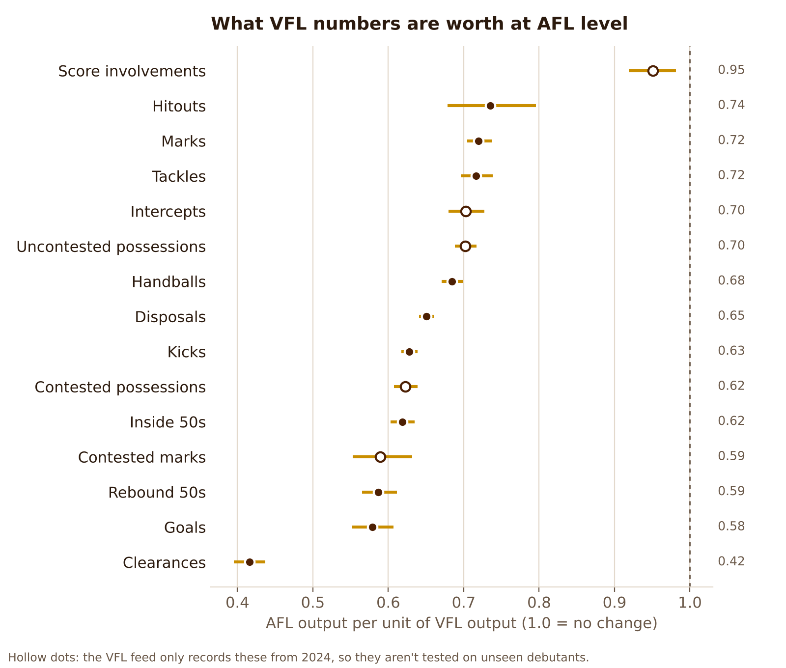
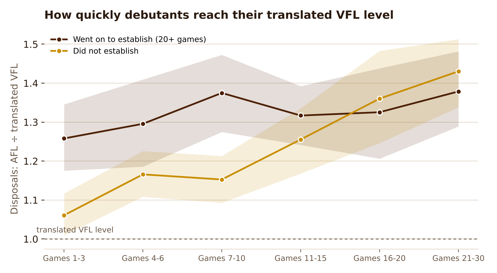

# The Step Up: VFL to AFL

A reproducible analysis of the step from the VFL to the AFL on public data, plus the weekly
review workflow a development program runs on top of it.

Written by Stefan Karydis, sport scientist and performance analyst.
**Live page:** https://stefank10.github.io/step-up/

## The three questions

1. **Translate.** What is a listed player's VFL output worth at AFL level?
2. **Readiness.** What did VFL players who went on to establish themselves in the AFL look like
   in their last ten VFL games before debut, and how quickly did debutants adapt?
3. **Review.** How do you turn a coded VFL game into a one-page review pack per player,
   with every clip linked to the vision and a running log of their development themes?

## Results

Data: 162,574 player-games (AFL 2015–26, VFL 2021–26). Earlier VFL seasons aren't in the public feed.

**1. Translate.** From 973 player-seasons at both levels (572 players), a VFL disposal is worth
about **0.65** of an AFL disposal (90% interval 0.64–0.66). Clearances shrink most (**0.42**);
score involvements hold up best (**0.95**). Clearances shrink mostly because of role: of 308 seasons
where a listed player was a VFL midfielder (3+ clearances a game), those barely used at AFL centre
bounces kept 23% of their clearances, against 65% for those given a full midfield role
(`src/clearances.py`). Tested on the 131 players who debuted in 2024–26,
with factors fitted only on earlier seasons, the blended estimate cut the typical error in
predicting their first ten AFL games by **43%** against raw VFL numbers and **15%** against
"a typical debutant in his role" (median across ten core stats). For rebound 50s and hitouts,
the plain translation beat the blend.



**2. Readiness.** Of 142 players who debuted in 2021–24 after 4+ VFL games, 39 (27%) played 20+
AFL games in their debut season and the next. Their last ten VFL games barely separated them from
the rest (cross-validated AUC **0.53**; disposals alone 0.49). Goals was the one clear signal.
What did separate them was their first few AFL games: those who established were **26%** above
their translated disposal level in games 1–3, against **6%** for those who didn't.



**3. Review.** A code window and pipeline that turn a coded game into a one-page pack per player
and a season-long development log. If the box score can't pick who's ready, the evidence has
to come from vision and the development coach's eye.

## Read this first

- **Public data only.** Champion Data statistics from the AFL website via
  [fitzRoy](https://github.com/jimmyday12/fitzRoy). No club data, GPS or vision is used or hosted.
- **Patterns, not verdicts.** Public data can't see role instructions, opposition quality,
  injuries or running load. The outputs are for starting a conversation with coaches.
- **Selection flatters VFL form.** Players are promoted after good VFL weeks and dropped after poor
  AFL ones. The adjacent-season factors (VFL in year t, AFL in year t+1) come out slightly higher (disposals 0.73), as expected.

## Method

| Step | File | What it does |
|---|---|---|
| Pull | `R/pull_data.R` | AFL 2015–26 and VFL 2018–26 player-match stats (VFL returns 2021 onwards), plus AFL lists by season. Both competitions share the Champion Data player ID. |
| Tidy | `src/load.py` | One row per player per game. Columns are found by suffix, so fitzRoy version changes don't break it. |
| A | `src/translate.py` | Translation factor per stat from player-seasons at both levels (harmonic-mean game weights, player-bootstrap 90% intervals). Validated on 2024–26 debutants with factors fitted only on earlier seasons, against raw VFL numbers and "a typical debutant in his role". AFL-equivalent cards for every listed player in the latest VFL season. |
| C | `src/readiness.py` | 2019–24 debutants (2021–24 in practice, given VFL coverage) with 4+ VFL games in the prior 400 days. "Established" = 20+ AFL games in the debut season and the next. Standardised differences (within VFL season), repeated cross-validated AUC, role benchmarks and an adaptation curve. |
| Clearances | `src/clearances.py` | Role vs level: listed VFL midfielders grouped by AFL centre-bounce attendances. |
| Charts | `src/figures.py` | Figures and the JSON the web page reads. |
| Review | `src/review_pack.py` | Sportscode-style XML + agreed themes → a one-page pack per player and `development_log.csv`. |

Roles come from what each player did (rebound 50s, clearances, goals, or 8+ hitouts for rucks),
scored within each competition and season, then split into key position and general by listed
height (194cm+). The VFL feed has no time on ground, pressure acts or rating points, and only
records contested possessions, intercepts, score involvements and contested marks from 2024;
those recent stats get factors and appear on the cards but aren't tested out of sample.

## Run it

```bash
pip install -r requirements.txt
./run_all.sh                     # pulls the data first if it isn't there (needs R + fitzRoy)
python -m pytest -q              # end-to-end test on simulated data + review-pack checks
```

Review packs from a coded game (from Hudl Sportscode or the
[browser code window](https://stefank10.github.io/step-up/code-window.html)):

```bash
python -m src.review_pack --codes my_game.xml --themes config/themes_example.json \
    --video "https://www.youtube.com/watch?v=..."
```

## With club data

With Champion Data's full feed, GPS and coded vision I'd add the physical side of the step up
(running and repeat-effort demands at each level, where my sport science background is most useful),
opposition-adjusted VFL output, and development themes linked directly to the review log.

## Related work

Academic work has also modelled how player involvement changes with competition tier
(*Modelling the effect of competition tier on player involvement and impact in Australian
Football*, International Journal of Performance Analysis in Sport, 2025). This project is an applied,
reproducible version aimed at a development program's weekly questions.
